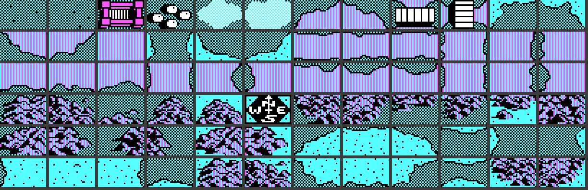
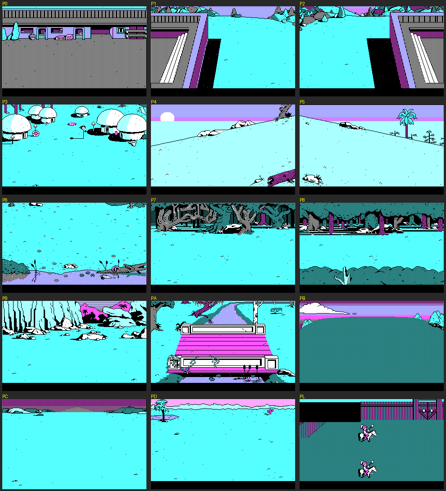

# WAR Analysis
Analysis of the game and its associated files, from the 3.5" disk version in [WAR_Original_Files_3.5](../WAR_Original_Files_3.5) (all files dated 22 June 1989). 

## Overview
The disk contains two builds of the game:
- **WAR.EXE** is the 4-colour CGA version. It reads the loose data files on the disk.
- **WARET.EXE** is the 16-colour EGA / VGA / Tandy 1000 version. It reads its graphics and data from a single archive, **WARET.DAT**.

## Executables
| File      | Size    | Purpose |
|-----------|---------|---------|
| WAR.EXE   | 98,304  | CGA version (320x200, 4 colours). "Copyright 1987 Broderbund". Linked with the Phoenix PLINK86 overlay linker: 8 code overlays are appended inside the EXE and paged in as needed. See [WAR.EXE.asm](WAR.EXE.asm). |
| WARET.EXE | 110,382 | EGA / VGA / Tandy 1000 version (16 colours), built with the Microsoft C 1988 runtime. Messages include "EGA or VGA card or Tandy 1000 required" and "Screen centering not possible with EGA". |
| WARET.DAT | 236,914 | Resource archive for WARET.EXE: the 16-colour graphics plus copies of the text and campaign files. See [WARET.DAT](#waretdat). |

## Configuration
| File  | Size | Contents |
|-------|------|----------|
| CNF   | 25   | Saved [options](#options) for WAR.EXE |
| CNFET | 26   | Saved [options](#options) for WARET.EXE |

## Options
The game options are:
| Option            | Values                     |
|-------------------|----------------------------|
| Display           | B/W, TV/Composite, RGB     |
| Fight delay       | Short, Medium, Long        |
| Data Disk Drive   | A:                         |
| Sounds            | On, Off, Do not play music |
| Center the screen |                            |
| Joystick          |                            |

## Graphics (CGA)
All CGA graphics use the standard 2 bits per pixel (4 colours: black, cyan, magenta, white), with dithering for extra shades.

### M - Map tiles
72 map-terrain tiles, each 32x20 pixels: grass, water and coastlines, bridges, forest, mountains, fort, village and the compass rose.

Format: repeated records of
| Length    | Purpose |
|-----------|---------|
| 2 bytes   | Width in words (4 = 8 bytes = 32 pixels) |
| 2 bytes   | Height / 2 (10 = 20 rows) |
| 160 bytes | Pixel data, row by row |

### P files - Full-screen pictures
P0-PD and PL are 320x200 battle backgrounds:

| File  | Picture |
|-------|---------|
| P0    | Inside a fort |
| P1    | Fort gate |
| P2    | Fort gate (other side) |
| P3    | Village |
| P4    | Hills |
| P5    | Hills (with palm tree) |
| P6    | River bank |
| P7    | Forest |
| P8    | Forest |
| P9    | Mountains / cliffs |
| PA    | Bridge |
| PB    | Plains |
| PC    | Plains |
| PD    | Plains (beach) |
| PL    | Probably an unused leftover / test screen: a wooden stockade fort with two identical plumed riders on white horses, stacked one above the other. A solid black block cuts into the top-left of the palisade, as if that part was never finished. |

Format: two fields (even lines, then odd lines). Each field is
| Length       | Purpose |
|--------------|---------|
| 2 bytes      | N = number of runs |
| N x 3 bytes  | Repeat count (1 byte), then a 2-byte word to repeat that many times |

Each field unpacks to 8,000 bytes (80 bytes x 100 lines), the same layout as CGA screen memory.

PE, PF, PG-PK and PM-PO use a different compression: pairs of [count, byte], unpacking to exactly 16,000 bytes. The pixel layout of these 10 files has **not been decoded yet** (plain CGA interlaced, linear and column layouts all give noise). PG-PK and PM-PO are the 8 largest files, so they may be the 8 opponent portraits (unconfirmed).

## O files - Screen resources
Each O file holds the sprites and on-screen text for one part of the program.
| File | Contents |
|------|----------|
| O0   | Campaign editor step 1 (map maker): small icons and "There are 6 steps to make a campaign..." |
| O1   | Step 2: placing squads and flags; squad info (speed, type, condition, food, march slow/fast) |
| O2   | Opponent descriptions (Athena, Alexander, Geronimo, Crazy Ivan, Caesar, Genghis Khan & Subotai, Napoleon, Sun Tzu) |
| O3   | Rules, story and title steps; "PREPARE FOR WAR!", go to war / make changes / quit; includes sprites |
| O4   | Main menus: make / change / remove campaign, teach squads new formations, Ye Olde Options Shoppe, Rulebook, Storybook, Map Maker, Enemy |
| O5   | In-game messages: surrender, ENEMY SIGHTED, FIGHTING, FLAG TAKEN, etc. |
| O6   | Battle screen: soldier sprites (archer, barbarian, knight) and battle commands (Attack, Retreat, Forward, Backoff, Stop) |
| O7   | No text: tables of signed 16-bit values. Probably battle movement / animation data |
| O8   | Formation editor ("Put pointer over a man to move", "Saving Formations") |

## Other data files
| File    | Size | Contents |
|---------|------|----------|
| TITLES  | 876  | Campaign menu for the WAR disk: file names (T0, T1...) and display titles |
| DTITLES | 876  | Same layout for a data disk; the first entry is "( war disk )" |
| F       | 420  | Probably the saved squad formations (unit type per man plus x/y positions). Unconfirmed |
| WARW    | 672  | Near-random data (scrambled). Probably the word list for the copy-protection question ("On page X, paragraph Y, what is word Z?"). WAR.EXE refers to it as "WarW" |

## T Files
The T0 to TA files contain information about for each included campaign. 

| File   | Campaign                |
|--------|-------------------------|
| T0     | The Race for the Flags  |
| T1     | The Battle of Pharsalus |
| T2     | The Contest of the Gods |
| T3     | Sherwood Forrest        |
| T4     | The Elusive Spy         |
| T5     | Custer's Last Stand     |
| T6     | The Rivalry             |
| T7     | A Tale of Three Islands |
| T8     | Wu vs Ch'u              |
| T9     | War in the Mountains    |
| TA     | Islands of Doom         |
| TITLES | Campaign titles         |

### File Structure
Each file is 1460 bytes. 
| Offset | Length    | Purpose               |
|--------|-----------|-----------------------|
| 0x0000 | 840 bytes | Campaign description  |
| 0x0348 | 200 bytes | Map (terrain grid)    |
| 0x0410 | 400 bytes | Army (squads & flags) |
| 0x05A0 | 2 bytes   | Opponent              |
| 0x05A2 | 18 bytes  | Rules                 |

In the campaign description, a 0x01 byte follows each capital letter. It looks like a marker for drawing a large capital.

### Opponents
| Value | Opponent            |
|-------|---------------------|
| 0x00  | Athena              |
| 0x01  | Alexander the Great |
| 0x02  | Geronimo            |
| 0x03  | Crazy Ivan          |
| 0x04  | Caesar              |
| 0x05  | Genghis Khan        |
| 0x06  | Napoleon Boneparte  |
| 0x07  | Sun Tzu             |

### Rules
| Offset | Rule                   | Values                                                             |
|--------|------------------------|--------------------------------------------------------------------|
| 0x05A2 | Villages supply food   | 0 = don't, 1 = supply                                              |
| 0x05A4 | Forts supply food      | 0 = don't, 1 = supply                                              |
| 0x05A6 | Supply line range      | 1 = short, 2 = medium, 4 = long                                    |
| 0x05A8 | Forts train men        | 30 = rarely, 60 = often, 120 = very often                          |
| 0x05AA | Your men are ... shape | 1 = in prime, 2 = in good , 4 = out of                             |
| 0x05AC | Enemy is seen          | 20 = when close, 40 = when far, 80 = always                        |
| 0x05AE | Water is               | 10 = shallow and calm, 20 = deep and calm, 40 = deep and dangerous |
| 0x05B0 | Mountain is            | 4 = low and safe, 8 = high but safe, 16 = high and risky           |
| 0x05B2 | Forest is              | 3 = sparse, 6 = dense                                              |

## WARET.DAT
The 16-colour version keeps its resources in one archive.

| Offset    | Length  | Purpose |
|-----------|---------|---------|
| 0x00000   | 4 bytes | Offset of the directory (0x39C47) |
| 0x39C47   | 5 bytes | Directory header; bytes 3-4 = number of entries (49) |
| 0x39C4C   | 49 x 6  | Entries: 2-byte record ID, 4-byte file offset |

Each record starts with a 2-byte payload length and a 1-byte checksum (sum of the payload bytes, low 8 bits), followed by the payload.

| Record IDs     | Contents |
|----------------|----------|
| 1-11, 60-73    | 25 compressed 16-colour pictures, matching the 25 P files (P0-PA and PB-PO by count, which would make PL record 71). Compression not decoded yet |
| 15, 16         | TITLES, DTITLES (compressed) |
| 20-28          | O0-O8, byte-for-byte identical to the loose files, so both versions share the same sprite data |
| 29             | F |
| 30             | Probably the 16-colour map tiles (equivalent of M) |
| 40-50          | T0-TA (compressed) |

## Other notes
- Both EXEs contain "DPQZSJHIU 2:94 EBWF NVSSZ", which is "COPYRIGHT 1983 DAVE MURRY" with each letter shifted by one.
- The header of [WAR.EXE.asm](WAR.EXE.asm) guesses that T files are terrain tiles, O files are opponent files and P files are scenario files. The analysis above shows T files are campaigns, O files are screen resources and P files are pictures.
