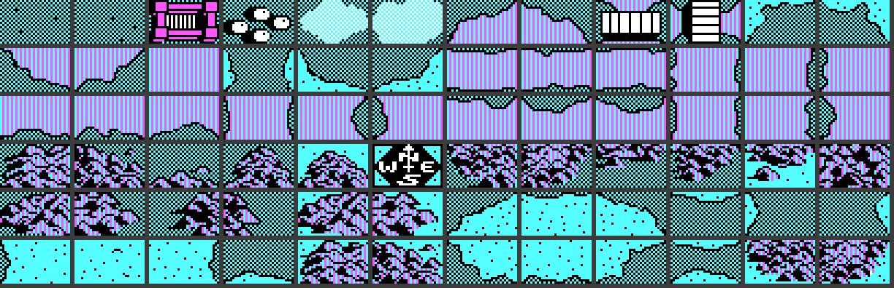
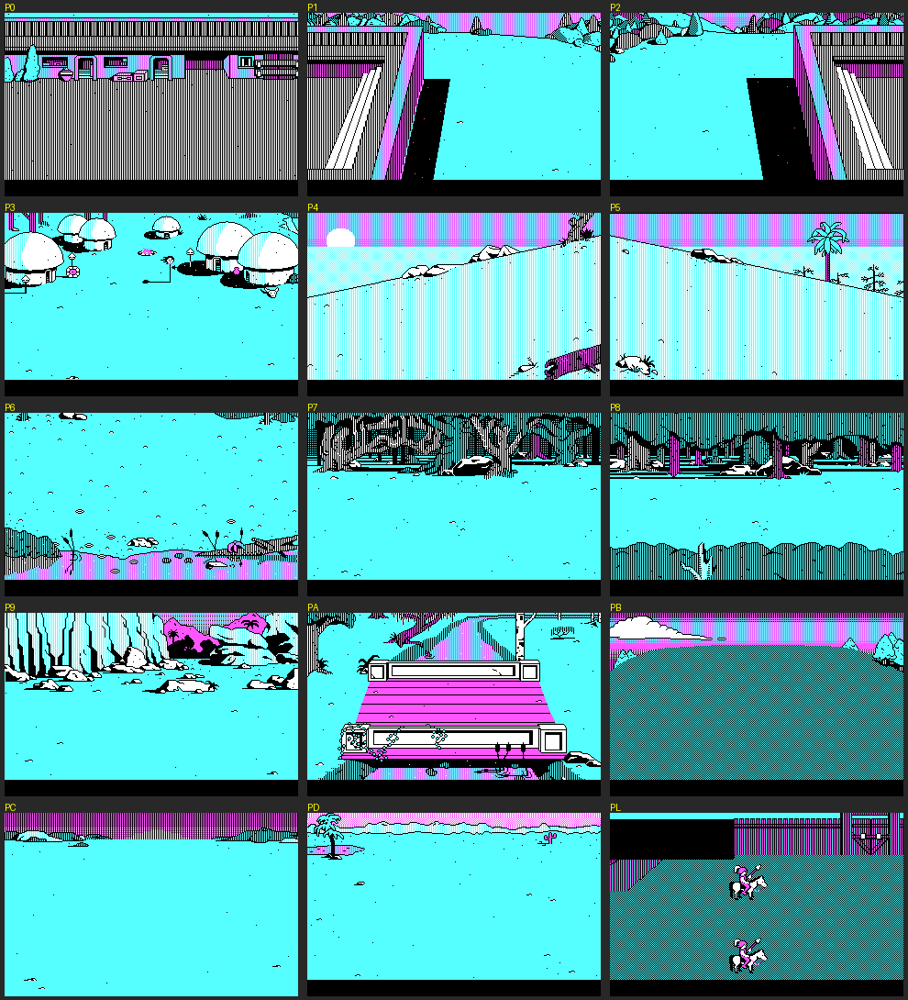
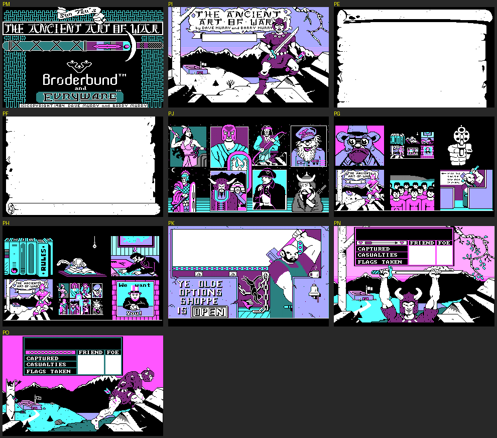
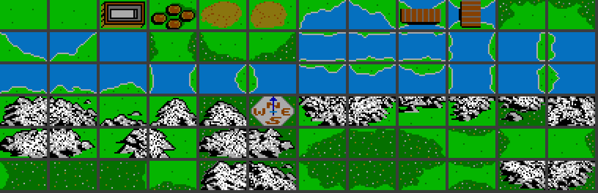
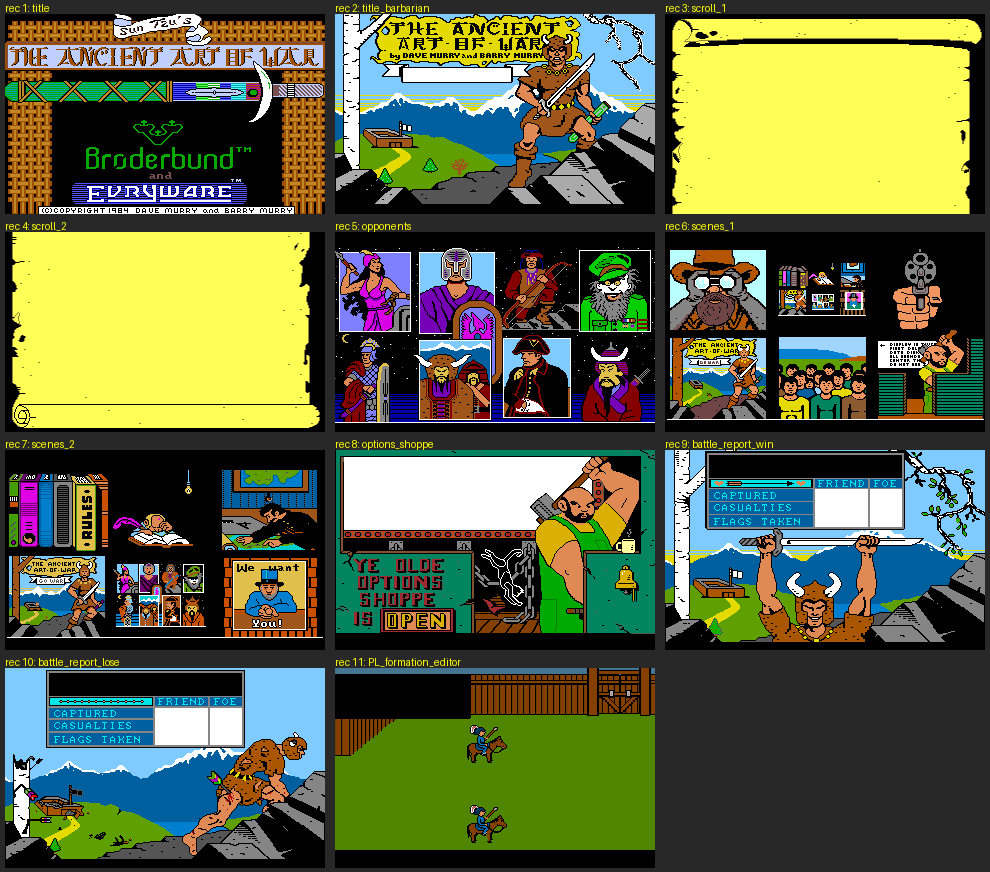
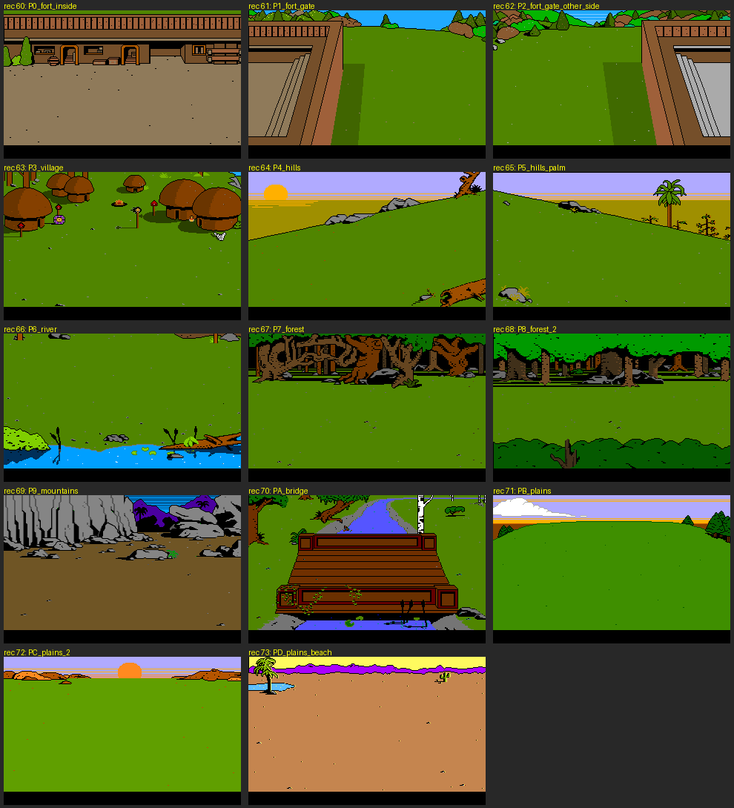

# WAR Analysis
Analysis of the game and its associated files, from the 3.5" disk version in [WAR_Original_Files_3.5](../WAR_Original_Files_3.5) (all files dated 22 June 1989). 

## Overview
The disk contains two builds of the game:
- **WAR.EXE** is the 4-colour CGA version. It reads the loose data files on the disk.
- **WARET.EXE** is the 16-colour EGA / VGA / Tandy 1000 version. It reads its graphics and data from a single archive, **WARET.DAT**.

## Executables
| File      | Size    | Purpose |
|-----------|---------|---------|
| WAR.EXE   | 98,304  | CGA version (320x200, 4 colours). "Copyright 1987 Broderbund". Linked with the Phoenix PLINK86 overlay linker: 7 code overlays and the data segment are stored inside the EXE. See [WAR.EXE structure](#warexe-structure) and the disassembly [WAR.EXE.asm](WAR.EXE.asm). |
| WARET.EXE | 110,382 | EGA / VGA / Tandy 1000 version (16 colours), built with the Microsoft C 1988 runtime. Messages include "EGA or VGA card or Tandy 1000 required" and "Screen centering not possible with EGA". The main program is compressed with Microsoft EXEPACK, and 6 overlay modules are appended to the file (at offsets 0x5E00, 0xC800, 0xEA00, 0xF800, 0x11200 and 0x17000). |
| WARET.DAT | 236,914 | Resource archive for WARET.EXE: the 16-colour graphics plus copies of the text and campaign files. See [WARET.DAT](#waretdat). |

## Configuration
| File  | Size | Contents |
|-------|------|----------|
| CNF   | 25   | Saved [options](#options) for WAR.EXE |
| CNFET | 26   | Saved [options](#options) for WARET.EXE |

## Options
The game options are:
| Option            | Values                     |
|-------------------|----------------------------|
| Display           | B&W, TV/Composite, RGB     |
| Fight delay       | Short, Medium, Long        |
| Data Disk Drive   | A:                         |
| Sounds            | On, Off, Do not play music |
| Center the screen |                            |
| Joystick          |                            |

## Graphics (CGA)
All the images in this README were extracted with [extract_graphics.py](../WAR_Graphics/extract_graphics.py), which writes individual PNGs into [WAR_Graphics/CGA](../WAR_Graphics/CGA) and [WAR_Graphics/VGA](../WAR_Graphics/VGA). Individual map tiles are in the `tiles` folder of each.

All CGA graphics use the standard 2 bits per pixel (4 colours: black, cyan, magenta, white), with dithering for extra shades.

### M - Map tiles
72 map-terrain tiles, each 32x20 pixels: grass, water and coastlines, bridges, forest, mountains, fort, village and the compass rose.

Format: repeated records of
| Length    | Purpose |
|-----------|---------|
| 2 bytes   | Width in words (4 = 8 bytes = 32 pixels) |
| 2 bytes   | Height / 2 (10 = 20 rows) |
| 160 bytes | Pixel data, row by row |

### P files - Full-screen pictures
All P files are 320x200 pictures. P0-PD are the battle backgrounds and PL is the formation editor background; they use a word run-length code. The others (PE-PO) are menu and title screens and use a byte run-length code.

| File  | Picture |
|-------|---------|
| P0    | Inside a fort |
| P1    | Fort gate |
| P2    | Fort gate (other side) |
| P3    | Village |
| P4    | Hills |
| P5    | Hills (with palm tree) |
| P6    | River bank |
| P7    | Forest |
| P8    | Forest |
| P9    | Mountains / cliffs |
| PA    | Bridge |
| PB    | Plains |
| PC    | Plains |
| PD    | Plains (beach) |
| PL    | Formation editor ("Teach squads new formations") background: a wooden stockade fort with two plumed riders. Loaded by overlay 5 together with O8. The black block top-left is probably where the editor draws its own panel. |

Format: two fields (even lines, then odd lines). Each field is
| Length       | Purpose |
|--------------|---------|
| 2 bytes      | N = number of runs |
| N x 3 bytes  | Repeat count (1 byte), then a 2-byte word to repeat that many times |

Each field unpacks to 8,000 bytes (80 bytes x 100 lines), the same layout as CGA screen memory.

PE-PO (except PL) use a byte run-length code. The file is a list of pairs of [count, byte] (byte repeated count times). The pairs **alternate** between the even-line field and the odd-line field: first pair to the even lines, next pair to the odd lines, and so on, until each field holds 8,000 bytes. This comes from the loader in WAR.EXE (`load_picture_rle8`, overlay 1 offset 8163h).

| File | Picture | 16-colour version (WARET.DAT record) |
|------|---------|------|
| PM   | Title screen | 1 |
| PI   | Title screen with the barbarian | 2 |
| PE   | Parchment scroll | 3 |
| PF   | Parchment scroll | 4 |
| PJ   | The 8 opponent portraits | 5 |
| PG   | Sheet of small scenes 1 (campaign menu) | 6 |
| PH   | Sheet of small scenes 2 (editor menu) | 7 |
| PK   | Ye Olde Options Shoppe | 8 |
| PN   | Battle report, victory | 9 |
| PO   | Battle report, defeat | 10 |

## O files - Screen resources
Each O file holds the sprites and on-screen text for one part of the program.
| File | Contents |
|------|----------|
| O0   | Campaign editor step 1 (map maker): small icons and "There are 6 steps to make a campaign..." |
| O1   | Step 2: placing squads and flags; squad info (speed, type, condition, food, march slow/fast) |
| O2   | Opponent descriptions (Athena, Alexander, Geronimo, Crazy Ivan, Caesar, Genghis Khan & Subotai, Napoleon, Sun Tzu) |
| O3   | Rules, story and title steps; "PREPARE FOR WAR!", go to war / make changes / quit; includes sprites |
| O4   | Main menus: make / change / remove campaign, teach squads new formations, Ye Olde Options Shoppe, Rulebook, Storybook, Map Maker, Enemy |
| O5   | In-game messages: surrender, ENEMY SIGHTED, FIGHTING, FLAG TAKEN, etc. |
| O6   | Battle screen: soldier sprites (archer, barbarian, knight) and battle commands (Attack, Retreat, Forward, Backoff, Stop) |
| O7   | No text: tables of signed 16-bit values. Probably battle movement / animation data |
| O8   | Formation editor ("Put pointer over a man to move", "Saving Formations") |

## Other data files
| File    | Size | Contents |
|---------|------|----------|
| TITLES  | 876  | Campaign menu for the WAR disk: file names (T0, T1...) and display titles |
| DTITLES | 876  | Same layout for a data disk; the first entry is "( war disk )" |
| F       | 420  | Probably the saved squad formations (unit type per man plus x/y positions). Unconfirmed |
| WARW    | 672  | Near-random data (scrambled). Probably the word list for the copy-protection question ("On page X, paragraph Y, what is word Z?"). WAR.EXE refers to it as "WarW" |

## T Files
The T0 to TA files contain information about for each included campaign. 

| File   | Campaign                |
|--------|-------------------------|
| T0     | The Race for the Flags  |
| T1     | The Battle of Pharsalus |
| T2     | The Contest of the Gods |
| T3     | Sherwood Forrest        |
| T4     | The Elusive Spy         |
| T5     | Custer's Last Stand     |
| T6     | The Rivalry             |
| T7     | A Tale of Three Islands |
| T8     | Wu vs Ch'u              |
| T9     | War in the Mountains    |
| TA     | Islands of Doom         |
| TITLES | Campaign titles         |

### File Structure
Each file is 1460 bytes. 
| Offset | Length    | Purpose               |
|--------|-----------|-----------------------|
| 0x0000 | 840 bytes | Campaign description  |
| 0x0348 | 200 bytes | Map (terrain grid)    |
| 0x0410 | 400 bytes | Army (squads & flags) |
| 0x05A0 | 2 bytes   | Opponent              |
| 0x05A2 | 18 bytes  | Rules                 |

In the campaign description, a 0x01 byte follows each capital letter. It looks like a marker for drawing a large capital.

### Map
The map is 10 tiles across and 20 tiles down (320x400 pixels), stored row by row from the top. Each byte is a tile number from 1 to 72: tile number N is tile N-1 in `M` (CGA) or in WARET.DAT record 30 (VGA). The CGA and VGA tile sets are in the same order, so the same map works for both. The game shows a little over 9 rows at a time (182 lines) with two text rows below, and scrolls up and down (see [Campaign play](#campaign-play-overlay-6)).

### Army (squads and flags)
The 400-byte army block holds up to 20 squads and 10 flags, stored field by field (all 20 values of one field, then the next field). WAR.EXE loads it to DS:9E60; the meaning of each field comes from the squad editor (overlay 3).

| Offset | Size     | Field |
|--------|----------|-------|
| 0      | 20 words | Side: -1 = friend (your white squads), 0 = foe (black squads) |
| 40     | 20 words | Speed: 1 = march fast, 2 = march, 3 = march slow |
| 80     | 20 words | 9999 = no squad in this slot (0 for squads that are present) |
| 120    | 20 words | X: byte column in the map buffer (multiply by 4 for pixels) |
| 160    | 20 words | Y: line pair in the map buffer (multiply by 2 for pixels) |
| 200    | 20 bytes | Formation (1-9) |
| 220    | 20 bytes | Condition |
| 240    | 20 bytes | Food |
| 260    | 10 words | Flag X (-1 = no flag) |
| 280    | 10 words | Flag Y |
| 300    | 10 words | Flag owner: -1 = white (friend), 0 = black |
| 320    | 20 bytes | Archers in the squad |
| 340    | 20 bytes | Knights |
| 360    | 20 bytes | Barbarians |
| 380    | 20 bytes | Spies |

X and Y give the top-left corner of the squad's 8x12 sprite on the 320x400 map. A new squad in the editor starts as a friend, with speed 2, formation 1, condition 35 and food 35.

For example, "The Race for the Flags" has 5 friendly squads (four of 14 archers and one of 14 knights) at the bottom of the map, 14 enemy squads in the middle, and a white and a black flag in the fort at the top. The manual describes it as "you're greatly outnumbered, and a horde of Mongolian warriors are between you and the fort".

### Map sprites
The squad and flag sprites are in WAR.EXE's data segment: five squad poses at DS:031C, 0338, 0354, 0370 and 038C (28 bytes each) and the flag at DS:03A8. Each is 8x12 pixels: a word width (1), a word height in line pairs (6), then for each line pair a big-endian 2-bit-per-pixel word for the even line and one for the odd line. WAR.EXE (rt:1B17) draws friendly squads and white flags as a white figure with a black outline on the left and right of each figure pixel, and enemy squads and black flags as a black figure with a white outline.

| Sprite | Used when (rt:19D9) |
|--------|---------------------|
| 0338   | Standing: no orders (how every squad starts) |
| 031C   | Marching |
| 0354   | Fighting |
| 0370   | Weak: condition 10 or less |
| 038C   | Small figure (squad state [A090] not 1) |

### Opponents
| Value | Opponent            |
|-------|---------------------|
| 0x00  | Athena              |
| 0x01  | Alexander the Great |
| 0x02  | Geronimo            |
| 0x03  | Crazy Ivan          |
| 0x04  | Caesar              |
| 0x05  | Genghis Khan        |
| 0x06  | Napoleon Boneparte  |
| 0x07  | Sun Tzu             |

### Rules
| Offset | Rule                   | Values                                                             |
|--------|------------------------|--------------------------------------------------------------------|
| 0x05A2 | Villages supply food   | 0 = don't, 1 = supply                                              |
| 0x05A4 | Forts supply food      | 0 = don't, 1 = supply                                              |
| 0x05A6 | Supply line range      | 1 = short, 2 = medium, 4 = long                                    |
| 0x05A8 | Forts train men        | 30 = rarely, 60 = often, 120 = very often                          |
| 0x05AA | Your men are ... shape | 1 = in prime, 2 = in good , 4 = out of                             |
| 0x05AC | Enemy is seen          | 20 = when close, 40 = when far, 80 = always                        |
| 0x05AE | Water is               | 10 = shallow and calm, 20 = deep and calm, 40 = deep and dangerous |
| 0x05B0 | Mountain is            | 4 = low and safe, 8 = high but safe, 16 = high and risky           |
| 0x05B2 | Forest is              | 3 = sparse, 6 = dense                                              |

## WARET.DAT
The 16-colour version keeps all its resources in one archive. It is fully decoded.

### Archive structure
| Offset    | Length  | Purpose |
|-----------|---------|---------|
| 0x00000   | 4 bytes | Offset of the directory (0x39C47) |
| 0x39C47   | 5 bytes | Directory header; bytes 3-4 = number of entries (49) |
| 0x39C4C   | 49 x 6  | Entries: 2-byte record ID, 4-byte file offset |

Each record starts with a 2-byte payload length and a 1-byte checksum (sum of the payload bytes, low 8 bits), followed by the payload.

### Compression
Compressed records use a simple run-length code. This is the same algorithm as the decoder in WARET.EXE (offset 0x16B2 in the EXEPACK-unpacked program):
- Read a signed byte n.
- If n is 0 to 127: copy the next n+1 bytes.
- If n is -1 to -128 (0xFF to 0x80): repeat the next byte -n times.
- Stop as soon as the required number of bytes has been produced. A run can be cut short, and a few records have unused bytes at the end.

Text and campaign records (T0-TA, TITLES, DTITLES) are a 2-byte unpacked size followed by the compressed data. They decode byte-for-byte to the loose files.

### Pictures
| Offset | Length | Purpose |
|--------|--------|---------|
| 0      | 48     | Palette: 16 colours x RGB, 8 bits per channel. **Every picture has its own palette.** |
| 48     | 2      | Unpacked size (32,006 for a full screen) |
| 50     | ...    | Compressed data |

The unpacked data starts with a 6-byte header: width (320), height (200) and bytes per row (160), each 2 bytes. The pixels follow at 4 bits per pixel, two pixels per byte (high nibble = left pixel), top row first.

The 16-colour map tiles (record 30) use the same palette + compressed layout. Unpacked they are 72 records of [2-byte width in words (8), 2-byte height / 2 (10), 320 bytes of pixels], so each tile is 32x20 pixels, the same layout as the CGA `M` file.

### Records
| Record IDs | Contents |
|------------|----------|
| 1          | Title screen ("Sun Tzu's The Ancient Art of War", Broderbund and Evryware) |
| 2          | Title screen with the barbarian |
| 3, 4       | Parchment scrolls |
| 5          | The 8 opponent portraits |
| 6, 7       | Sheets of small scenes (rulebook, "We want You!", etc.) |
| 8          | Ye Olde Options Shoppe |
| 9, 10      | Battle report screens (captured, casualties, flags taken): victory, defeat |
| 11         | PL: formation editor background |
| 15, 16     | TITLES, DTITLES (compressed) |
| 20-28      | O0-O8, byte-for-byte identical to the loose files, so both versions share the same sprite data |
| 29         | F |
| 30         | Map tiles (16 colours) |
| 40-50      | T0-TA (compressed) |
| 60-73      | Battle backgrounds P0-PD (16 colours) |

## WAR.EXE structure
[WAR.EXE.asm](WAR.EXE.asm) is a complete annotated disassembly of the CGA program. It is generated by the scripts in [disassembler](disassembler) (`python3 disassembler/gen_asm.py`, needs `pip install capstone`). Every line shows the address the code runs at, the file offset and the bytes, and the output has been checked byte-for-byte against WAR.EXE.

The program is linked with Phoenix PLINK86. The resident code is in segment 0000, the startup and overlay loader in segment 028D, and the data segment (strings, tables, the 8x8 font) is stored at the end of the file and loaded at startup. Overlays 1 and 3-7 all load at the same address (0000:30F0), so only one of them is in memory at a time; overlay 2 loads after overlay 1.

| Overlay | File offset | Size  | Purpose |
|---------|-------------|-------|---------|
| 1       | 0x032F0     | 21,552 | Main program: startup, title and menu screens, options (CNF), saving (S), data disk, hardware detection, picture loader for PE-PO |
| 2       | 0x08720     | 1,504  | Manual copy protection (WarW) and welcome message |
| 3       | 0x08D00     | 6,896  | Campaign editor: placing squads and flags (O1) |
| 4       | 0x0A7F0     | 2,768  | Campaign editor: map maker (O0) |
| 5       | 0x0B2C0     | 5,776  | Formation editor (O8, PL) |
| 6       | 0x0C950     | 23,408 | Campaign play: the strategic map (O5) |
| 7       | 0x124C0     | 20,000 | Battle screen (O6, O7, P0-PD) |
| data    | 0x172E0     | 2,880  | Data segment (loaded at startup) |

Other findings from the disassembly:
- **Two copy-protection checks.** Overlay 1 reads track 10 of the original floppy directly (INT 13h), including a deliberately unreadable sector numbered 241, and compares 16 words. Overlay 2 loads WarW and asks for a word from the manual ("On page N, what is word N in paragraph N").
- **Sound:** the PC speaker, and the Tandy 1000 / PCjr sound chip (port C0h), even in the CGA version.
- **Input:** keyboard and joystick (game port 201h).
- **Video:** CGA mode 4; the program also checks for a Hercules card.
- Campaign file names come from a table of "T0".."TA" in the data segment; the saved game is the file S on the data disk.
- Both EXEs contain "DPQZSJHIU 2:94 EBWF NVSSZ", which is "COPYRIGHT 1983 DAVE MURRY" with each letter shifted by one.

## Campaign play (overlay 6)
Overlay 6 runs the strategic map. The remake's [play.c](../WAR_Remake/src/play.c) follows it routine by routine, and [WAR.EXE.asm](WAR.EXE.asm) names the routines. Positions use the units of the CGA map buffer: x is a byte column (4 pixels, 0-79) and y a line pair (2 pixels, 0-199).

### Screen and cursor
- The map takes the top 198 - 8n lines, where n is the number of text rows below it ([A5C0]), with a white line under it. Normally n is 2: row 23 for messages and row 24 for the command line, so the map shows 182 lines. Each new message adds a row (two at most, then they scroll; the newest is on top) and Info adds five.
- The view starts at the bottom of the map (top line pair 6Dh) with the cursor at (26h, 91h). The cursor moves one byte or one line pair at a time, repeating every iteration while a cursor key is held. The view follows the cursor, keeping it within 56h line pairs of the top. - and + (also Tab and Ctrl) scroll by 2 line pairs.
- The cursor is a cross. While a path is traced it is an open box around the squad's 8x12 sprite, moving every other iteration. The squad's position is the top of the box, and the squad walks exactly where the box went.
- The cursor is on a squad when it is one byte right of the squad and 1 line pair above to 3 below its top.

| Mode ([A92F]) | Command line |
|------|------|
| 0 normal | `View  Time (slow)  Clear  Surrender` (Clear only when there are messages) |
| 1 on a squad | `Move Info Size Formation Detach Join Zoom` (Move, Formation, Detach and Join only for your own squads not fighting; Detach when the squad has 2 or more men and a squad slot is free; Join when another of your squads is within 3 bytes and 7 line pairs and this one has under 14 men; Zoom when it is fighting) |
| 2 tracing | `Trace path to destination and press [M]` / `Mark Cancel` |
| 3 Size | `KNIGHT:n BARBARIAN:n ARCHER:n SPY:n` / `End` (any key) |
| 4 Info | Orders ("Marching in a northwest direction", "STOPPED - when moving: MARCH"), condition and food bars on a 0-100 scale with + or -, `Speed End` |
| 5 Detach / Join | The table of the two squads (see Detach, Join and Formation) |
| 50 Formation | `[+][-] End` and `Formation: n`, with the formation in a box |
| 99 | A question, such as `Surrender -- Are you sure? (Y or N)` |

### Main loop and time
Each iteration of the main loop copies the map to the screen and reads a key. If no key is down and no path is being traced, a tick counter counts up to the Time setting ([A51C]): T steps it from 64 (slow, the start) to 16 (medium), 4 (fast) and 1 (faster). Copying the 16 KB map each iteration limits an IBM PC/XT to about 20 iterations a second, and faster machines are slowed to match, so slow time is a tick about every 3 seconds.

Each tick: sighting and encounters, the enemy's moves, then every squad's movement. Every 16 ticks: food and supply, and forts training men.

### Squad tables
The army block from the T file is loaded to DS:9E60, and the program keeps more arrays of 20 after it:

| Address | Contents |
|---------|----------|
| 9EB0 | Moving speed: 0 = stopped, 1-3 = moving at that speed, 9999 = no squad |
| 9FF0 | Men (archers + knights + barbarians; spies are not counted) |
| A068 | Address in the map buffer (0B68h + y\*80 + x) |
| A0CC | Ticks until the next step |
| A0F4 | Fighting (the other squad's number + 1) |
| A11C | Seen by the other side |
| A144 | Position of the next step in the path memory |
| A194 | Has a path |
| A51E | Address of the destination mark (9999 = none) |
| A8D9 | Ticks per step on the current ground |
| A090 | Figure: 1 normal, 2 spies only (drawn small, no Formation, two spy squads never meet) |
| A02C | Enemy: destination cell |
| A0B8 | Enemy: has a destination (byte) |
| A16C | Enemy: next step in the route memory (DS:9B6A) |
| A1BC | Enemy: following a route |

### Paths
All paths share a 1000-byte circular path memory at DS:9782. Move looks for the longest free run in it and refuses if it is under 10 steps. Each move of the box is stored as a signed byte, dy\*80 + dx (bigger moves from scrolling are split into steps of 80). M writes 99 to end the path, a small white mark at the destination, and starts the squad. The squad takes one step whenever its countdown runs out, clearing each step as it goes. If the box runs into another squad's path, the destination is marked there.

### Movement and terrain
Ticks per step = speed (1 fast, 2 march, 3 slow) times a factor for the ground under the squad's feet, plus the speed again if the squad has knights. The factor is the campaign's Forest, Mountain or Water rule, or 1 on open ground; enemy squads use their commander's forest and mountain values (DS:A4FC, A4FA) instead.

The ground comes from the map tile and the CGA pixels (squad_terrain). Tiles 3 (fort), 4 (village), 5 and 6 (hills), 9 and 10 (bridges) are open ground. Otherwise the program looks at the 8 pixels at the squad's feet (line 2y+10, then 2y+8) as four pairs of 2-bit pixels: a pair 1,1 is forest, 1,0 open ground, 1,2 on a water tile (7, 8, 13-15, 19-36) is water, and 2,1 or 0,0 on a mountain tile (37-54, 65, 66, 71, 72) is mountain.

Each tick a moving squad in risky ground may lose a man: 2 in 128 in high, risky mountains (rule 16) or deep water (rule 20 or more), and another 4 in 128 in dangerous water (rule 40). The man lost is chosen at random (lose_man). A squad that loses its last man is gone: "NOTICE - SQUAD LOST IN THE MOUNTAINS" or "DROWNED IN THE ...".

In Info, S steps the speed slow, march, fast, then stop (a moving squad halts until S is pressed again). A squad with condition under 15 can't march fast, and under 5 can't march.

### Sighting and encounters
For each of your squads and each enemy squad, the distance is 2 x columns + line pairs. A squad in a fort, or on a hill (unless the other is in a fort), counts as being in the middle of its tile, and the distance in each direction is then 3 less. Spies halve the distance. Within 3 columns and 5 line pairs the squads meet (see Battles on the map; a fort keeps out a squad without archers, and two squads of spies only pass each other). Otherwise the enemy squad is seen when the distance is under the Enemy-seen rule (20 or 40), and with the rule at 80 every squad is always shown; "ALERT - ENEMY SIGHTED IN THE NORTH..." appears for a squad not seen before (within 20 when the rule is 80), at most once per region of the map.

### Supply, food and condition
Every 16 ticks the program works out how strongly each side holds each of the 200 map cells (supply_map, DS:8F74). Each squad counts 4 per man, spies included, as a minus number for your squads and a plus number for the enemy's. A squad counts nothing in water, a quarter in the mountains, double in a fort or on a hill, and half if its condition is under 10. Each cell then takes an eighth of each of its eight neighbours (a quarter of that if the cell is mountains; water cells take nothing), and this spreading is done twice. View (V) draws the result as a small map: white for strongly yours, dotted white for weakly yours, and, only when the enemy is always seen, black and dotted for the enemy.

A squad's supply distance is the number of diagonal steps (in bytes and line pairs) to the nearest village or fort that its side holds (under -1 for yours, over 1 for the enemy), counting villages only if the rule lets them supply food and forts likewise, divided by the supply-line range rule (1, 2 or 4). Then, every 16 ticks (food_and_condition):

| | Your squads | Enemy squads |
|---|---|---|
| Food | -1 if the supply distance is over 20, -1 more over 40, +1 under 10; set to 49 in a supplying village or fort | the same, but +2 under 10 |
| Condition, fast march | - 2 x the shape rule | -1 |
| Condition, march | - the shape rule | -1 |
| Condition, slow march | no change | no change |
| Condition, standing | +1 | +1 |
| Condition, food under 10 | -3 | -2 |
| Condition, in a village or fort with food over 10 | +1 | +1 |

Food and condition stay between 1 and 49 (the Info scale puts 100 at 48). A squad on fast march with condition under 15 drops to march, and one on march under 5 drops to slow march. In Info, Condition shows - while the squad marches fast or normally or is hungry, and + while it rests; Food shows - when the supply distance is over 20 and + under 10.

### Forts and flags
Every 16 ticks, for each fort, the first squad in it with under 14 men has a 90 in 128 chance of being considered, and then a chance of (forts-train-men rule) in 128 of gaining an archer, knight or barbarian (one in three each). A full enemy squad resting in a fort splits off a man into a free slot instead (enemy_split_in_fort).

Each tick, a squad within 1 byte of the other side's flag and from 1 line pair above to 2 below it takes it: "URGENT - FLAG TAKEN IN THE ..." when the enemy takes one of yours, "ENEMY FLAG CAPTURED IN THE ..." when you take one. The side with no flags left loses. When a campaign starts, a side with no flag in the T file gets one at a random place (x 8-71, y 31-158), so Sherwood Forest, which has only the sheriff's flag, gets a white flag somewhere in the middle of the map.

### The end of a game
In normal mode Alt+S (the keyboard handler keeps Shift at [0547], Alt at [0549], Ctrl at [054B], Del at [054D]) makes campaign_play return 100, and main saves the game (save_game); S alone asks to surrender.

The game ends when one side has no flags or no squads (game_over): every enemy squad is shown, the command line says "You Won ... [Enter] to continue" or "You Lost ...", the map can still be scrolled, and Enter goes on to the battle report. Each time a squad is lost the program also compares the two sides: if your men divided by the enemy's men reaches the opponent's surrender ratio (DS:A4EA, from O2) and you have over 20 men, the opponent offers to surrender, once ("Your opponent offers to surrender. Do you accept? (Y or N)" in a box at the top of the screen). Accepting ends the game as a win.

The result code [A6F7] tells the battle report how it ended: 0 you took their flags, 1 they surrendered, 2 they ran out of squads, 10 they took your flags, 11 you surrendered, 12 you ran out of squads.

### Detach, Join and Formation
- **Formation** (F, formation_choose): the squad's formation (1 if it was 0) can be changed with + and - (1-9, wrapping). A third text row opens, `Formation: n` is at row 23 column 21, and formation_preview draws the men in a box at the bottom left (bytes 0-17, lines 86-190): each man, placed by place_formation as in a battle, is an 8x6 letter A, B or K (DS:03C4, 03D0, 03DC) at byte (x / 2 - 22, from 1 to 15) and line 2 x (y + 16) (88 to 184). E or a cursor key ends. Time stops.
- **Detach** (D, when a squad slot is free) and **Join** (J, with a squad of the same side within 3 bytes and 7 line pairs, if either has under 14 men) open detach_join. Detach first makes a new squad in the free slot (new_squad_from: the same place, 1 byte to the right, the same food, condition and formation, speed 2). The text area grows to show one row per kind of man that either squad has, under `OLD GROUP --> NEW GROUP` or `GROUP 1 <-- GROUP 2`, with the counts at columns 8 and 28. The two squads' food and condition become the average weighted by men. K, B, A and S move one knight, barbarian, archer or spy in the direction of the arrow; J and D turn the arrow; a squad that reaches 14 men turns it back. Row 24 lists only the kinds that can still move, then the other direction. E ends: empty squads are removed and a new squad with men appears on the map.

### Opponents' values
O2 holds the eight opponents' descriptions and, from offset 277h, 19 words for each opponent (38 bytes, in the order of the Opponents table). choose_opponent copies one set to DS:A4DC-A500. Most of them steer the enemy's moves (see The enemy commander); chances are out of 128, like random():

| Address | Use | Athena | Alexander | Geronimo | Crazy Ivan | Caesar | Genghis Khan | Napoleon | Sun Tzu |
|---|---|---|---|---|---|---|---|---|---|
| A4DC | Squads at the target before choosing a new one | 1 | 7 | 2 | 1 | 10 | 5 | 6 | 4 |
| A4DE | (not used) | 0 | 110 | 35 | 60 | 50 | 90 | 110 | 100 |
| A4E0 | (not used) | 0 | 150 | 30 | 20 | 20 | 90 | 120 | 100 |
| A4E2 | Chance of going straight for your flag; 150 or more: never holds ground | 200 | 25 | 40 | 10 | 45 | 65 | 40 | 70 |
| A4E4 | How much your hold on a flag counts against attacking it | -900 | -80 | -10 | -300 | -100 | -40 | -60 | -25 |
| A4E6 | Chance that a squad holding ground may move on | 130 | 20 | 130 | 75 | 50 | 40 | 25 | 25 |
| A4E8 | Squads kept guarding its own flag | 0 | 3 | 0 | 1 | 1 | 2 | 3 | 3 |
| A4EA | Surrender ratio | 500 | 3 | 4 | 2 | 5 | 4 | 3 | 3 |
| A4EC | Food under which a squad goes to eat | 5 | 20 | 15 | 5 | 10 | 20 | 15 | 20 |
| A4EE | Condition a squad holding ground needs before moving on | 25 | 35 | 48 | 10 | 40 | 45 | 48 | 48 |
| A4F0 | Chance of a random change in each choice | 35 | 55 | 40 | 100 | 50 | 35 | 50 | 65 |
| A4F2 | Distance (cells) at which a marching squad attacks | 5 | 3 | 4 | 1 | 3 | 2 | 3 | 4 |
| A4F4 | Least strength (squad_strength) to attack a squad | -100 | -20 | 10 | -100 | -40 | -10 | 10 | 20 |
| A4F6 | Chance of going for one of your flags within 30 steps | 75 | 100 | 120 | 20 | 90 | 65 | 100 | 110 |
| A4F8 | (not used) | -300 | -20 | -35 | -100 | -60 | -50 | -10 | -5 |
| A4FA | Mountain factor for enemy squads | 16 | 16 | 1 | 20 | 16 | 4 | 8 | 2 |
| A4FC | Forest factor for enemy squads | 8 | 8 | 1 | 10 | 8 | 2 | 5 | 1 |
| A4FE | Speed when going for a flag or a squad (1 fast, 2 march, 3 slow) | 1 | 2 | 2 | 3 | 1 | 2 | 2 | 2 |
| A500 | How strongly you must hold a cell before it costs the enemy more to cross | -300 | -50 | -85 | -200 | -150 | -120 | -60 | -40 |

Athena never offers to surrender, and Geronimo's warriors cross forest and mountains as fast as open ground. When a general is losing badly (fewer than 3 squads on either side, or 4 times as many enemy squads as yours) or you refuse its surrender, check_victory sets A4E2 to 200, A4E8 to 0 and A4F4 to -100: every squad goes for your flags and attacks anything. A4E8 also drops by one whenever the enemy has fewer than twice that many squads.

### The enemy commander
The enemy's moves are in overlay 6 (ai_ routines, ovl6:7698-8C4E). Each tick, after sighting and encounters, ai_tick picks the next enemy squad that is standing still and not fighting (round robin, [A8CD]) and gives it orders; at the start of a game it does this 5 times.

- **Cell tables** (init_cell_costs, each time campaign_play starts): the cost of crossing each of the 200 map cells (DS:8B8C): the water rule (doubled over 10) for water, the general's mountain factor (doubled over 14) for mountains, his forest factor for forest, 3 for a fort, else 1. The worth of a fort ([A8D1]: 80 if forts supply food, else 30, plus the forts-train-men rule, less 20 for each fort on the map, at least 10), a village ([A8D3]: 90, or 50 if forts also supply food, or 5 if villages don't; less 10 a village, at least 5) and a bridge ([A8D5]: 25 less 5 a bridge, at least 5). ai_cell_values (DS:9294) gives each cell its worth, 2 for hills, and adds 130 ([A8D7]) where you have a flag; it is worked out again whenever a flag changes hands.
- **Flags**: count_flags picks the enemy flag to guard ([A510], cell [A512]), one in a fort if there is one. ai_choose_attack_flag picks your flag to go for ([A516]): the one you hold least strongly (supply map less A4E4, never above 0), less 8 per cell from the last one, minus a random amount with chance A4F0. It chooses again when the enemy takes that flag.
- **Holding ground** (ai_decide): a squad in a cell worth something, or on its own flag, stays: in a fort it stays while it has under 14 men or is alone there, or while one of your squads is within 2 cells and it has food over 10. Otherwise it stays unless the general is daring (A4E2 150 or more), or it is hungry (food under A4EC) and over 9 supply steps from food; while [AAEF] is clear a squad holding ground only moves on with chance about (A4E6 + 1)/128 x 28/128; the guards of the flag stay if there are no more than A4E8 of them; and a squad rests until its condition reaches A4EE.
- **Where to go** (ai_plan): to food (the nearest village or fort that feeds, less half the enemy's hold on it) if hungry; to guard its own flag, at fast march, if fewer than A4E8 squads are there or on the way; otherwise to the target cell [A514]. When A4DC squads stand at the target the general (60 in 128) chooses a new one: your flag (chance A4E2), or the cell worth most: its worth, +100 if you hold it only weakly (between A500 and 0) and it is not a fort, 150 for an empty fort, minus a random amount with chance A4F0.
- **Routes** (ai_route): a search over the map cells from the squad to the destination, trying the 8 directions nearest the goal first; each cell costs its crossing cost plus, where you hold it more strongly than A500, half the difference + 3. The route stops at the first sight of the goal (not always the cheapest). Up to 21 cells of it, then only the first half, go into a 200-byte route memory (DS:9B6A: 1-8 = E, SE, S, SW, W, NW, N, NE, from the table at the start of O5; 99 ends it); the squad plans again when it has marched that half.
- **Marching** (ai_follow_route): each time a squad on a route stops, it goes for one of your flags within 30 steps and not across water (chance A4F6, unless 3 or more of your squads stand on it, or it is in a fort held by your squads and the squad has no archers), or attacks your nearest squad within A4F2 cells that it is strong enough for (squad_strength at least A4F4) and can reach in a straight line without crossing water (or mountains, if the mountain factor is over 7), unless that squad is in a fort and it has no archers. For a flag or a squad the path is up to 35 or 4 x distance steps at speed A4FE. Otherwise it marches to the middle of the next cell of its route (up to 30 steps, written into the shared path memory like your paths, across only four steps in five). At the end of the route it gives its men to a squad of its side nearby that has room (ai_join, twice) and stands on its own flag if it is within 4 steps.
- **Squads splitting** (enemy_split_in_fort): every 16 ticks a full enemy squad standing in a fort with no more than 2 other squads gives one man (a barbarian, knight, archer or spy, in that order) to a new squad in the second free slot.
- **Giving up a target**: when an enemy squad standing on the target cell is beaten (on the map or on the battle screen), the general picks a new target with chance (127 - A4E2)/128.

### Battles on the map
When one of your squads comes within 3 columns and 5 line pairs of an enemy squad (encounters_and_sighting), the program compares them (squad_strength): 4 x the difference in men plus half the battle edge, where the battle edge (battle_edge, -30 to 30) is the difference in condition, +15 for a squad on a hill, and -30 for a squad in water or made up only of spies. If the result is over 50 the weaker squad is captured without a fight ("ENEMY CAPTURED IN THE ..." / "YOUR SQUAD CAPTURED IN THE ..."), unless it is in a fort. Otherwise both squads stop, "WARNING - ENCOUNTER IN THE ..." appears and a counter starts for each ([A004]).

Every main-loop iteration (map_battles) the counter goes up by 1 (by 3 at the fastest time) until it reaches the fight delay ([A6E3]: 200, 400 or 800 from the Options Shoppe; 400 by default, about 20 seconds). Until then Zoom is on the command line of both squads, and Z goes to the battle screen. When the counter runs out, "A L E R T  - FIGHTING IN THE ..." appears and the squads fight on the map: the program swaps their colours every iteration so they blink, and each iteration each squad kills one of the other's men with a chance of (battle_edge x 2 + 60, doubled for archers in a fort)/128 x 25/128. The man lost is chosen by lose_man (archers beat knights, knights beat barbarians, barbarians beat archers). When a squad has no fighting men left, "NOTICE  - BATTLE WON / LOST IN THE ..." appears, the winner's condition is halved, and squads that had a path carry on along it.

### The battle screen (overlay 7)
Zoom makes campaign_play return 2, and main runs overlay 7 (battle), then campaign_play again. The remake follows it in WAR_Remake/src/battle.c.

- **Background** (battle_setup), from the map tiles under your squad and the enemy squad: both in a fort P0; enemy in a fort P1; you in a fort P2; either in a village P3; you on a hill P4; the enemy on a hill P5; either in water P6; your tile 11, 12, 16-18, 58-60, 64 or 70 P7; you in forest P8; you in mountains P9; either on a bridge PA; both on hills PB; otherwise PC (75 in 128) or PD. The background number ([A5CA]) also sets, for each of the 80 byte columns, the highest and lowest line soldiers can stand on (a slope on hills, a narrow strip on bridges).
- **Enemy formation**, by opponent: Alexander and Caesar 3 (sometimes 2), Geronimo 5 or 4, Athena 4 (sometimes 2), Crazy Ivan 5 or 1; the others choose from the squads (2 if the enemy has archers and over 4 other men, 4 if it has no archers but you do, else 3). If you have no archers but the enemy does, usually 1. A squad in a fort uses formation 0, which lines its men along the wall.
- **Formations**: the F file (420 bytes) is three tables of 10 formations x 14 men: the type (0 knight, 1 barbarian, 2 archer), x (byte column, 44-75; archers 2 further back) and y. Formations 1-5 are fixed, 6-9 can be changed in the formation editor, and 0 is the fort formation. place_formation (rt:09D3) gives each place to a man of that type, or the first type still left (knights, barbarians, archers). The enemy's squad is mirrored (x = 76 - x), so you fight from the right and the enemy from the left.
- **Skill**: each side gets 45 +- 2 x battle_edge (at most +-40), [AB89] and [AB8B].
- **Soldiers**: up to 28 at once, in arrays of 28 (DS:9C32 type, 9C6A side, 9CA2 screen address, 9CDA x, 9D12 y, A696 current animation script, 9D4A script state).
- **Sprites**: O6 holds 37 soldier pictures (knights, barbarians and archers standing, walking, fighting, shooting and dead; WAR_Graphics/CGA/battle_soldiers.png), each a width word (in 8-pixel units), a height word (in line pairs) and 2-bit pixels, drawn like the map sprites with a white or black outline. O7 holds 6 more (arrows and small pictures, from O7+434h).
- **Animation scripts**: each action (stand, walk, attack, shoot, die, retreat...) has three scripts, for knights, barbarians and archers, in O6 (from 1C8Ah) and O7, listed by pointer tables at DS:AAF1-AB73. A script is a list of steps of three words: a move in the off-screen buffer (dy x 80 + dx, as in the map's path memory), a sprite number (0-46, through the table at DS:A931) and a value, ending with 101 or 102. battle_soldiers picks a soldier's next script each frame from his orders (Attack, Backoff, Forward, Stop, per type), the terrain and the nearest enemy.
- **Commands** (battle_input, text in O6): "Archer", "Barbarian", "Knight", "Squad", then "Attack", "Backoff", "Forward", "Stop"; "Retreat"; at the end "You lost N  They lost N".
- **Pace**: with fewer than 15 men on the field the program waits (28 - men) x 50 delay units each frame, so small battles run at the same speed as big ones.
- **Each frame** (battle loop): battle_soldiers, battle_alive_types, battle_arrows_fly, battle_arrows_hit, then the command keys (battle_input) and R for Retreat. Until someone attacks ([A8CD] = 20) both sides stand; A starts the attack, and the enemy may start it first (Athena always; Geronimo and Genghis Khan 2 in 128 a frame; the others but Crazy Ivan 1 in 128). Your orders then start at Stop (archers on a fort wall shoot at once).
- **Targets** (battle_check_target, battle_choose_target): each soldier keeps his target while it lives and is within 4 columns and 3 line pairs. Otherwise he takes the nearest enemy (distance dx + dy), preferring a man who is attacking him; barbarians count archers, and knights count barbarians, at half the distance across. When no enemy is left the battle ends: [A8C9] = 7 (9 at a fort) frames, and the loser's spies are captured.
- **Moving** (battle_toward, battle_close_in): soldiers on Attack (and all the enemy's) step up/down and across toward their target, and stand 30 times in 128 (always at a fort). Within 2 columns and 1 line pair they fight; a friend in the way is stepped round. Forward and Backoff last 15 frames.
- **Blows**: when a fighting script reaches its blow (state 2) the man hits with a chance of (skill + 40)/128, if 90 in 128 he gets a blow in at all; always against archers or a retreating side, and a knight gets 35 in 128 extra against barbarians.
- **Archers** (battle_archer_aim): an archer shoots when 128 x chance < AB99[archers - 1] (O7+7D0h: 100, 64, 43 ... 9, so a few archers shoot often), at the first enemy for which another roll is under AB99[enemy men left - 1], in one of 20 directions (straight, or at a slope of 1, 2 or 3-9). The arrow leaves when the shooting picture comes (battle_loose_arrow) with power skill x 2 + 40, losing 4 a frame. Direction tables in O7: 1F6h width and 20Bh height of the hit box, 220h dx and 235h dy (bytes), 24Ah the screen address change (words).
- **Arrows hit** (battle_arrows_hit) a man in the hit box when a roll is under the power and (85 in 128, or always for archers): the enemy's arrows never hit their own men, yours hit yours 28 in 128 (never while retreating); a knight's armour turns 39 in 128 and a barbarian dodges 77 in 128.
- **Falling** (battle_kill): a man's death script depends on where he stands (off a fort wall at three heights). A side whose fort has no archers left is beaten; a side with skill under 6 may break and run (each loss, chance (12 - skill)/128; never Athena's or Caesar's men).
- **Retreat** (battle_retreat): R (or a rout) sets [A8C9] = 75, and the retreating squad moves away on the map by 1-4 columns and 0-7 line pairs (doubled on hills and at forts), with its path cleared. The other side's skill becomes 85 and, if you retreat, the enemy's condition goes to condition x 2 + 5. Retreating men walk off the side of the field; when all have gone the battle ends after 8 frames (16 at a fort).
- **The end**: one frame before the end the arrows are cleared and "You lost N man/men .... They lost N man/men" shows. Afterwards both squads' condition is halved, the fight is over (neither squad fights on the map) and the campaign carries on.

### Random numbers
random() (rt:20AA) adds successive words of WAR.EXE's own code (offsets 0BB8h-2327h) to the last value and keeps the low 7 bits (0-127). It is seeded from the BIOS tick count. The delay routine also calls it, so the sequence depends on timing.

## Title pages and menus (overlay 1)
main runs ovl1_startup (CNF, the manual question of overlay 2, PM with "presented by" and a tune), then game_init (thunk 1), which shows the title page and returns 0 to play, 2 for the campaign menu, 1 to quit. After a game it runs battle_report (thunk 5); Alt+S runs save_game (thunk 4).

- **Title page** (show_title_barbarian): PI with a box at line 58, byte 19, holding "go to war", "make changes" or "quit" in O3's small capitals; -/+ (also Tab and Ctrl) change it and the box blinks (xor_box 17, 54, 25 x 5). Each turn of the loop with no key blinks the box once (delays of 1 1/2 x and 1 x [0948]); after 189 turns the demo starts (see below).
- **Scrolls** (show_scroll, [A692] = which page): PE above PF make a 320 x 400 parchment in CGA palette 0 (yellow, red, green). scroll_open draws the top curl and the bottom curl, and scroll_unroll moves the bottom curl down over whatever was on the screen; scroll_rollup moves it back up. The text is 26 rows of 32 characters at DS:9782, written from line 52 and byte 6 with rows 12 lines apart: capitals are 16 x 10 glyphs and take two cells (TITLES and the T files put 0x01 after each capital), lowercase letters are 8 x 8 small capitals two lines down, and each cell is first cleared with a parchment glyph. The sword pointer (O3+8B4h) is ANDed at byte 3. The window follows the pointer between lines 88 and 142.
  - 1, TITLES: the campaign titles from TITLES (rows 3, 5, 7, ...); the last, "( data disk )", reads TITLES from the data disk (made from DTITLES), whose first entry, "( war disk )", goes back. If the data disk has a saved game S, "Saved game             New campaigns" asks first (S or N).
  - 4, story: the T file's 840 characters; -/+ scroll the window 4 lines (to line 216), Enter goes on, Esc goes back to the titles.
  - 2, rules: one sentence per rule (rules_text); Space changes the rule under the pointer: villages and forts toggle, supply range 1-2-4, training 30-60-120 (rarely, often, very often), shape 4-2-1 (out of, in good, in prime shape), enemy seen 20-40-80, water 10-20-40, mountains 4-8-16, forest 3-6.
- **Opponents** (choose_opponent): PJ, with the opponent's description from O2 on rows 0 and 1 and a frame blinking around the portrait (xor_frame; positions, widths and heights at O2+247h, 257h, 267h). The campaign's opponent is shown first ("[+] to change the opponent, [Enter] to continue"); after +, -/+ change it with a box sweeping across the top rows. Enter copies the 19 values from O2+277h to DS:A4DC. Then a random quote of the 39 at O2+4CDh is printed on rows 11 and 12 between two white lines, with "PREPARE FOR WAR!" on row 24.
- **Campaign menu** (campaign_menu, from "make changes"): PG, with O4's six choices (Make a new campaign, Change a campaign, Remove a campaign from a data disk, Return to title page, Teach squads new formations, Ye Olde Options Shoppe) on row 0 and a frame around the chosen scene (O4+19Bh, 1A7h, 1B3h).
- **Options Shoppe** (options_shoppe): PK, six lines in small capitals and the pointer; Space changes the one under the pointer: display ([A6DF] black/white, tv/composite, rgb; it sets the palette registers on machines that have them), fight delay ([A6E3] 200, 400, 800), data disk drive ([A6F5], only with two drives), sounds ([A6E1] off, do not play music, on, and the internal/external speaker on a Tandy), center the screen (moves the picture), joystick ([A6E7], with calibration). Enter saves the 25 bytes from DS:A6DE to CNF if anything changed.
- **Battle report** (battle_report): PN for a win or PO for a loss. Rows 1 and 2 at column 6: "Victory was yours / by capturing the flags / with a surrender / in a war of attrition", or the opponent's line ("Athena crushed you", ... "Wise Tzu outwitted you") and "by capturing your flags / when you surrendered / in a war of attrition". The numbers are drawn with the scroll digits, three cells each, at bytes 41 (yours) and 52 (theirs) on lines 40 (men captured, [A6F9] and [A6FB]), 52 (casualties, [A6FD] and [A6FF]) and 66 (flags taken, [A703] and [A701]). "Press any key to continue." returns to the title page.
- **Saving** (save_game): a black screen; if the data disk already has S, "WARNING: Any previously saved game on your data disk will be erased." and "Continue   Quit" (C saves, Q goes back to the game); then "Saving Game", 217Eh bytes of the data segment are written to S, and "<C>ontinue with game or <Q>uit?" (Q leaves the program).

### The demo
The flag [A6D8] is 1 while the demo runs and 2 when it should zoom to an encounter.
- **Start** (show_title_barbarian, ovl1:42CC): after 189 turns with no key, "    quit    " and then "demo " are written in the box, row 24 is cleared, and "One moment, please" shows while campaign 3 + (random & 7) (T3-TA) loads from the WAR disk. The opponent is the first (Athena, [A67C] = 0) with its values from O2+277h, then [A4FE] = 3, and the enemy seen rule [A70F] = 80, so every squad is seen.
- **game_init**: time is set to faster ([A51C] = 1 instead of 64). Whenever the enemy seen rule is 80 or more, in the demo or not, every squad's spies become barbarians, since spies are of no use when all is seen. Also, in every game, [A4E8] (squads the opponent keeps on guard) is cut to half the enemy squads.
- **campaign_play**: the demo first presses keypad - (scroll up from the bottom of the map). Any real key ([0531]) ends the demo. Each turn poll_input keeps the demo's key, or 1 time in 32 picks keypad - or + at random. While a key is down no tick is played, so the demo scrolls the whole way up or down, and campaign_input clears the key at the top or bottom of the map. Messages about the north or south of the map (print_map_region) set - or + to scroll there. Your squads get no orders.
- **Encounter** (msg_encounter): the flag becomes 2 and the squad is selected; campaign_input then sets mode 1 and Z, and the battle screen starts at once. A question or the end of the game (mode 99) returns 3 and ends the demo; game_over doesn't wait for Enter.
- **Battle** (overlay 7): all three of your groups are ordered to attack at the start, and keep the order when the attack begins (no reset to Stop). battle_input turns any key into 63h, which ends the battle at once. At the end the flag goes back to 1.
- **The end**: main skips the battle report (battle_report returns at once in the demo) and goes back to game_init, which clears the flag and shows the title page again.
- **Timing**: delay(n) calls random() n x m times, where m (1/2, 1, 1 1/2, 2, ...) grows with the calibration [0948] (loop count in 26 ms). A delay given as a constant takes about the same time on any PC, but the title box's delays are themselves multiples of [0948], so they take longer on faster PCs. In DOSBox at 1500 cycles (about a PC/XT) the box flickers about 8 times a second and the demo starts 23 s after the title page appears, then plays for 20-30 s. The scrolling turns of the loop, which skip the game's work, ran about 50 a second (the whole map in about a second).
